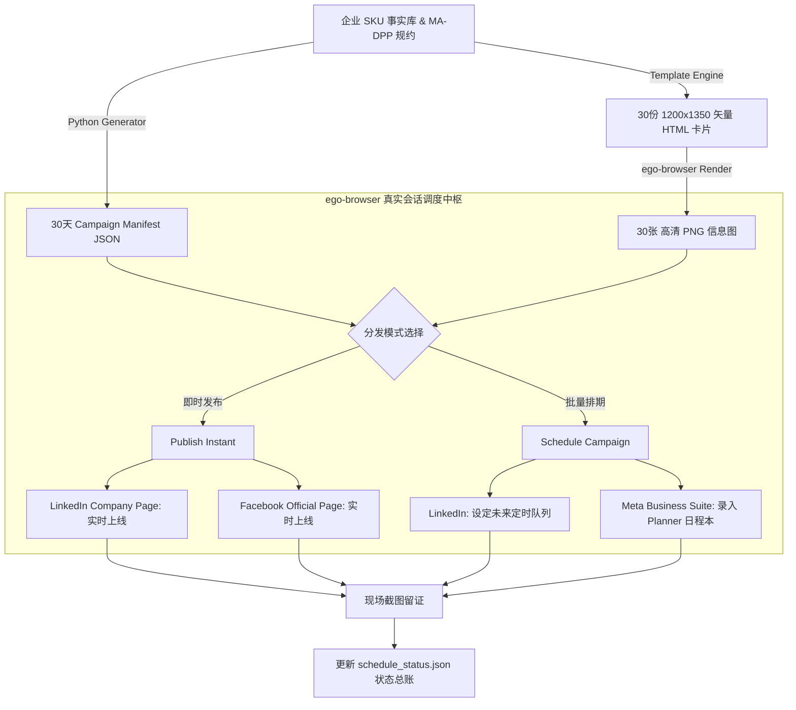

# B2B MA-DPP 社交全媒体发布与自动化排期 Skill (`b2b-ma-dpp-social-publisher`)

[](https://github.com/cnproduct/b2b-ma-dpp-social-publisher)
[](https://eur-lex.europa.eu/)
[](https://www.iso.org/)
[](LICENSE)

针对半导体、工业制造与硬科技出海 B2B 企业的 **MA-DPP (欧盟数字产品护照 / Digital Product Passport)** 社交全媒体图文生成与自动化排期发布 Skill。

基于 `ego-browser` 深度整合已登录的真实浏览器环境（复用现存 Cookies、企业管理主页权限及指纹环境），彻底解决社媒平台（LinkedIn & Meta）针对自动化工具的封控、验证码拦截与 API 权限孤岛难题，实现从 **技术事实抽取 -> 1200×1350 高清工业信息图渲染 -> 30天全媒体排期矩阵注入 -> 现场截图存证** 的全生命周期闭环。

---

## 🌟 核心能力矩阵

1. **MA-DPP 技术事实档案库生成**
   - 依据欧盟可持续产品生态设计法规 (EU ESPR 2024/1781) 与 ISO/IEC 15459 Node 100015 根节点标准。
   - 自动绑定晶圆批次、SGS CSTC 权威实验室报告、RoHS 2.0 / REACH SVHC 绿色声明及 SHA-256 防篡改数字指纹。
2. **1200×1350 (4:5 黄金纵向) 高清工业信息图渲染**
   - 现代暗黑半导体科技风排版、发光渐变轮廓、晶圆微纳背景、权威徽章封印与可扫码验证二维码。
   - 纯 CSS/HTML 矢量卡片架构，毫秒级通过无头浏览器离线批量光栅化为出版级 PNG 图片。
3. **LinkedIn 公司主页 (Company Page) 深度逆向自动化**
   - 支持向企业公开信息流即时发帖。
   - 支持进入原生排期弹窗（设定指定日期、15分钟粒度时间槽、媒体附件、富文本注入与排期确认）。
4. **Facebook 官方主页 (Meta Business Suite) 深度逆向自动化 (严格对齐 LinkedIn)**
   - 突破 Meta Composer 复杂层级定位难题，精准识别真实上传按钮与时间调节器。
   - **默认图文全量规范**：强制发布“完整技术文案 + 权威护照落地页链接 + 完整 Hashtags 标签矩阵 + 1200×1350 专业信息图”，坚决杜绝空图帖。
   - **React / Draft.js 状态双向同步**：通过 Playwright/ego 原生 `page.fill` 触发合成事件通道，彻底解决传统 `document.execCommand('insertText')` 导致的 React state 空字符串（“这篇帖子没有文字内容”）严重缺陷。
   - **防误直发硬校验**：在排期模式下严格检测提交按钮必须为“预设时间”，杜绝排期脚本误直接发帖。
   - 自动同步至 Meta Business Suite **日程本 (Planner)**，支持多周/月度排期大盘。
   - 自动识别并优雅关闭发帖后的促销引导弹窗与商品标记推介。
5. **全流程状态追踪与留证审计**
   - 本地 `schedule_status.json` 实时维护每一篇帖子的排期状态、时间戳与校验信息。
   - 支持自动化回访 LinkedIn 与 Meta 队列，导出排期大盘截图。

---

## 🏗️ 架构流程图



---

## 📂 仓库目录结构

```
b2b-ma-dpp-social-publisher/
├── SKILL.md                              # Antigravity 标准 Skill 定义文件
├── README.md                             # 核心技术文档与实战手册
├── package.json                          # 项目元数据与依赖定义
├── scripts/
│   ├── generate_30_campaign.py           # 30天文案与 HTML 卡片编译脚本
│   ├── render_infographics.mjs           # 批量将 HTML 卡片光栅化为 PNG 图像
│   ├── publish_instant_linkedin.mjs      # LinkedIn 即时发布脚本
│   ├── publish_instant_facebook.mjs      # Facebook 即时发布脚本
│   ├── schedule_campaign.mjs             # 30天全自动多平台错峰排期主控脚本
│   └── verify_planner.mjs                # 排期日历大盘验证与截图审计脚本
├── references/
│   ├── linkedin-company-automation-spec.md  # LinkedIn 公司主页 DOM 逆向与选择器
│   ├── meta-business-suite-spec.md          # Meta Business Suite 排期规范与避坑指南
│   ├── ma-dpp-regulatory-framework.md       # MA-DPP 欧盟法规框架与技术证据体系
│   └── campaign-scheduling-best-practices.md # B2B 社交媒体排期峰值时段与频控策略
├── templates/
│   ├── infographic_card_template.html    # 1200x1350 信息图 HTML 模板
│   └── campaign_manifest_template.json   # 30天营销战役 JSON 示例骨架
└── assets/
    └── sample_infographic.png            # 示例 4:5 芯片数字产品护照高清效果图
```

---

## 🚀 快速上手

### 步骤 1: 准备环境
确保本地已安装 Node.js (>=18) 与 Python (>=3.9)，并安装有 `ego-browser`：
```bash
ego-browser skill
```

### 步骤 2: 编译 30 天营销战役
```bash
python3 scripts/generate_30_campaign.py
ego-browser nodejs < scripts/render_infographics.mjs
```

### 步骤 3: 运行自动化排期
```bash
ego-browser nodejs < scripts/schedule_campaign.mjs
```

### 步骤 4: 导出排期大盘审计留证
```bash
ego-browser nodejs < scripts/verify_planner.mjs
```

---

## 📄 许可证

MIT License. Designed by cnproduct.
