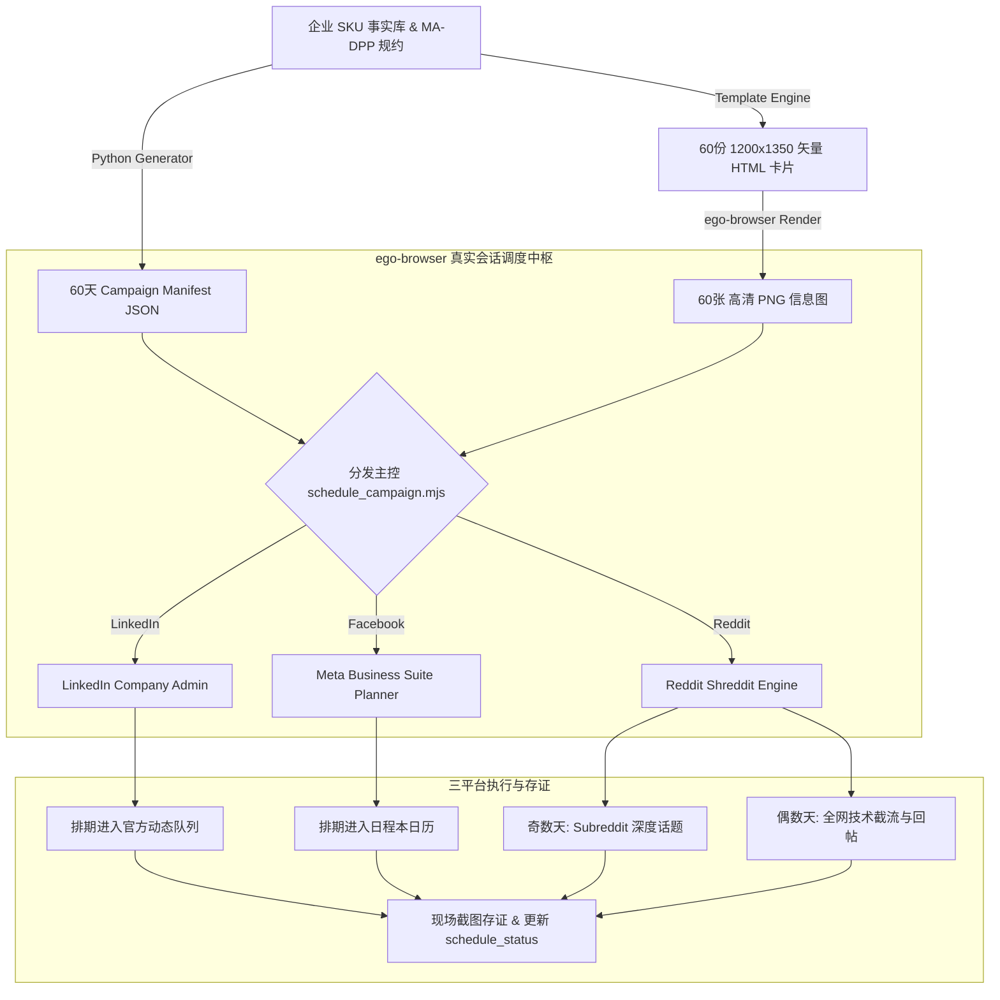

# B2B MA-DPP 三平台社交全媒体发布与自动化排期 Skill (`b2b-ma-dpp-social-publisher`)

[](https://github.com/cnproduct/b2b-ma-dpp-social-publisher)
[](https://eur-lex.europa.eu/)
[](https://www.iso.org/)
[](LICENSE)

针对半导体、工业制造与硬科技出海 B2B 企业的 **MA-DPP (欧盟数字产品护照 / Digital Product Passport)** 社交全媒体图文生成与自动化排期发布 Skill。

覆盖三大主流社交与工程师社区：
1. **LinkedIn 公司主页 (Company Page)**
2. **Facebook 官方主页 (Meta Business Suite)**
3. **Reddit 技术社区 (r/embedded, r/ECE, r/SupplyChainTalks 等 7 大核心 Subreddit)**

基于 `ego-browser` 深度整合已登录的真实浏览器环境（复用现存 Cookies、企业管理主页权限及指纹环境），彻底解决社媒平台针对自动化工具的封控、验证码拦截与 API 权限孤岛难题，实现从 **技术事实抽取 -> 1200×1350 高清工业信息图渲染 -> 60天三平台排期矩阵注入 -> 现场截图存证** 的全生命周期闭环。

---

## 🌟 核心能力矩阵

1. **MA-DPP 技术事实档案库生成**
   - 依据欧盟可持续产品生态设计法规 (EU ESPR 2024/1781) 与 ISO/IEC 15459 Node 100015 根节点标准。
   - 自动绑定晶圆批次、SGS CSTC 权威实验室报告、RoHS 2.0 / REACH SVHC 绿色声明及 SHA-256 防篡改数字指纹。
2. **1200×1350 (4:5 黄金纵向) 高清工业信息图渲染**
   - 现代暗黑半导体科技风排版、发光渐变轮廓、晶圆微纳背景、权威徽章封印与可扫码验证二维码。
   - 纯 CSS/HTML 矢量卡片架构，毫秒级通过无头浏览器离线批量光栅化为出版级 PNG 图片。
3. **LinkedIn 公司主页 (Company Page) 深度逆向自动化**
   - 支持向企业公开信息流即时发帖。
   - 支持进入原生排期弹窗（设定指定日期、15分钟粒度时间槽、媒体附件、富文本注入与排期确认）。
4. **Facebook 官方主页 (Meta Business Suite) 深度逆向自动化**
   - **默认图文全量规范**：强制发布“完整技术文案 + 权威护照落地页链接 + 完整 Hashtags 标签矩阵 + 1200×1350 专业信息图”，坚决杜绝空图帖。
   - **React / Draft.js 状态双向同步**：通过 Playwright/ego 原生 `page.fill` 触发合成事件通道，彻底解决传统 `document.execCommand('insertText')` 导致的 React state 空字符串（“这篇帖子没有文字内容”）严重缺陷。
   - **防误直发硬校验**：在排期模式下严格检测提交按钮必须为“预设时间”，杜绝排期脚本误直接发帖。
   - 自动同步至 Meta Business Suite **日程本 (Planner)**，支持多周/月度排期大盘。
5. **Reddit 硬核社区双轨 60 天交替获客**
   - **奇数天 (30 个技术锚点话题)**：在 `r/embedded`, `r/ECE`, `r/SupplyChainTalks` 等板块抛出工程选型难题与标准探讨，激发技术极客回帖。
   - **偶数天 (30 个专家技术解答)**：全网关键词侦测（RS-485、CAN FD、ESPR 护照数据收集等），提供带引脚定义、计算公式与测试数据的资深工程师级回帖。
   - **Shreddit 架构穿透**：精准操作 Shadow DOM 内的 `<post-composer-title>`、`[contenteditable]` 编辑器与异步加载的 `comment_composer`。
6. **全流程状态追踪与留证审计**
   - 本地 `schedule_status_60_days.json` 实时维护每一篇帖子的排期状态、时间戳与校验信息。
   - 支持自动化回访三大平台队列，导出排期大盘现场截图。

---

## 🏗️ 架构流程图



---

## 🚀 常用执行命令

```bash
# 1. 批量生成 60 天图文与矢量卡片
python3 scripts/generate_60_campaign.py

# 2. 批量渲染高清信息图
ego-browser nodejs < scripts/render_infographics.mjs

### 默认官方发布主页 (Default Official Targets)
- **LinkedIn 官方主页**: `https://www.linkedin.com/company/144112219/admin/page-posts/published/?editPageActiveTab=info&shareMsgArgs=null` (MA-DPP 官方企业主页，Company ID: `144112219`)
- **Facebook 官方主页**: `https://www.facebook.com/profile.php?id=100066493838069` (Ma-dpp 官方公共主页，Page ID: `100066493838069`)
- **Meta Business Suite 调度器**: `https://business.facebook.com/latest/composer?asset_id=100066493838069` (资产 ID: `100066493838069`)

### 3. 即时发帖到各平台
node scripts/publish_instant_linkedin.mjs
node scripts/publish_instant_facebook.mjs
node scripts/publish_instant_reddit.mjs --mode post --subreddit embedded --day 1

# 4. 回复 Reddit 上的高意向技术求助帖
node scripts/publish_instant_reddit.mjs --mode reply --url "<target_reddit_url>" --body "<technical_reply>"

# 5. 全网检索并回复 Reddit 上的技术帖
node scripts/reddit_scout_and_reply.mjs --query "RS-485 transceiver" --subreddit embedded

# 6. 执行全量三平台自动化排期调度
node scripts/schedule_campaign.mjs --platform all --days 1-60
```

---

## 📚 策略与技术文档

- [Reddit B2B 技术社区获客与 60 天排期战略规范](references/reddit-b2b-strategy-spec.md)
- [LinkedIn 公司主页自动化规范与 DOM 映射](references/linkedin-company-automation-spec.md)
- [Meta Business Suite 排期与发帖规范](references/meta-business-suite-spec.md)
- [MA-DPP 欧盟法规框架与技术证据链](references/ma-dpp-regulatory-framework.md)
- [B2B 社交媒体排期最佳实践与频控策略](references/campaign-scheduling-best-practices.md)
