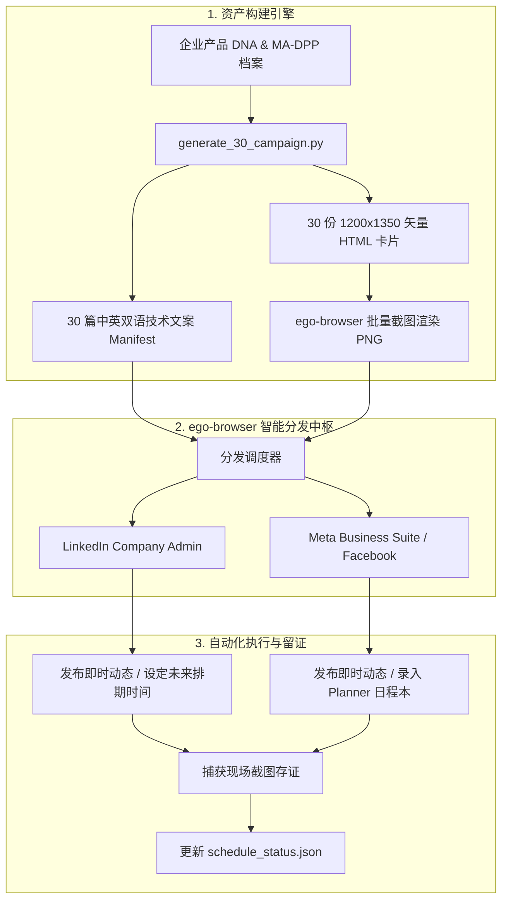

# B2B MA-DPP 社交全媒体发布与自动化排期 Skill (`b2b-ma-dpp-social-publisher`)

本 Skill 专门用于工业出海与半导体 B2B 品牌，围绕 **欧盟数字产品护照 (MA-DPP / EU ESPR 2024/1781 & ISO/IEC 15459 Node 100015)** 构建全生命周期技术内容生产与社交分发自动化闭环。

通过与 `ego-browser` 深度整合，直接复用用户已登录的真实浏览器环境、Cookie 与权限上下文，彻底攻克现代社交媒体平台的反爬、验证码与 API 限制，实现 **LinkedIn 公司主页 (Company Page)** 与 **Facebook 官方主页 (Meta Business Suite)** 的：
1. **即时图文发布 (Instant Publishing)**
2. **长周期矩阵化定时排期 (Multi-Day Campaign Scheduling)**
3. **真实发布留证与排期大盘审计 (Planner & Feed Verification)**

---

## 核心架构与能力矩阵



---

## 一、支持的工作模式

### 模式 A: 30天矩阵化自动化排期 (Batch Scheduling)
针对企业主推的 24~30 个关键 SKU 或合规主题，按照欧美 B2B 采购高峰时段（CET 上午/下午错峰时间，如 `09:15`, `14:30`, `10:45`, `16:15`），自动上传对应高清信息图、填充结构化工程文案、在日历选择器中选定未来日期并提交排期。

### 模式 B: 即时发布重大公告 (Instant Publishing)
在需要发布官方 Launch Announcement、展会快讯或合规白皮书发布时，一键调度已登录的社媒主页，直接向公共信息流（Public Feed）发布带有 1200×1350 视觉海报的高清图文。

### 模式 C: 排期日历与内容大盘审计 (Planner Verification)
通过自动化脚本定期访问 LinkedIn 的“已设定发布时间的动态”清单与 Meta Business Suite 的“日程本 (Planner)”，导出当前生效的排期日历截图，确保零漏排、零断档。

---

## 二、快速使用指南

### 1. 批量生成 30 天图文与信息图
在项目根目录运行生成脚本：
```bash
python3 scripts/generate_30_campaign.py
```
该脚本将生成：
- `campaign_manifest_30_days.json`: 30 天排期时间戳、SKU、双语技术文案、标签与护照 URL。
- `html_cards/day_01.html` 至 `day_30.html`: 1200×1350 4:5 纵向工业暗黑科技风信息图源码。

批量渲染 PNG 图片：
```bash
ego-browser nodejs < scripts/render_infographics.mjs
```

---

### 2. 即时发布单篇图文到 LinkedIn 和 Facebook
```bash
# 即时发布到 LinkedIn Company Page
ego-browser nodejs < scripts/publish_instant_linkedin.mjs

# 即时发布到 Facebook 官方主页
ego-browser nodejs < scripts/publish_instant_facebook.mjs
```

---

### 3. 执行全量 30 天自动化排期
```bash
ego-browser nodejs < scripts/schedule_campaign.mjs
```
脚本将按以下逻辑自动化运行：
1. 读取 `campaign_manifest_30_days.json` 与 `schedule_status.json`。
2. 逐天执行 LinkedIn 公司主页排期（设定日期、时间槽、媒体文件、文案并点击“设定时间”）。
3. 逐天执行 Meta Business Suite 排期（上传照片、输入文案、开启定时开关、设定时分与日期并点击“预设时间”）。
4. 实时持久化每个任务状态至 `schedule_status.json`。

---

### 4. 抓取排期现场大盘截图
```bash
ego-browser nodejs < scripts/verify_planner.mjs
```
将自动截取：
- LinkedIn Company Page 已排期动态弹窗截图
- Meta Business Suite 日程本 (Planner) 月度视图截图

---

## 三、反爬与浏览器自动化技术细节

本 Skill 经过真实 DOM 逆向与工程验证，总结了 LinkedIn 与 Meta 的关键交互要点：

### 1. LinkedIn 公司主页 (Company Page)
- **创建动态入口**: 搜索包含文本 `创建` 的按钮，随后点击二级菜单 `发动态`。
- **排期时钟图标**: 定位 `button[aria-label="设定动态发布时间"]` 或 `.share-actions__scheduled-post-btn`。
- **日期选择器**: 点击 `#share-post__scheduled-date` 激活 Artdeco Calendar 弹窗。若跨月（如12月），需点击 `.artdeco-calendar__next-month`。在日历网格中需严格排除 `.artdeco-calendar-day-btn--diff-month`，使用真实的坐标点击 `page.mouse.click(x, y)` 触发 Ember.js 数据绑定。
- **时间选择器**: 点击 `#share-post__scheduled-time`，并在下拉列表框中按 15 分钟槽位选中目标时间。
- **媒体文件上传**: 使用 `page.waitForFileChooser()` 配合点击 `button[aria-label="添加媒体文件"]`，并使用 `chooser.setFiles(absolutePath)`。
- **文案注入**: Quill 富文本编辑器 (`.ql-editor`) 必须先获取焦点 `editor.focus()`，再通过 `document.execCommand('insertText', false, text)` 注入，确保触发表单变更侦听。

### 2. Facebook (Meta Business Suite & Native Page)
- **照片上传按钮定位**: Meta 页面外层存在多个宽高庞大的容器，必须准确定位内部的 `[role="button"]`（文本包含 `添加照片`），坐标通常在左侧面板居中偏左位置，使用 `page.mouse.click(x, y)` 激活文件选择器。
- **定时开关**: 定位复选框 `input[aria-label="设置日期和时间"]`。
- **时分输入**: 分别定位 `input[aria-label="小时"]` 与 `input[aria-label="分钟"]`，使用键盘 Backspace 清空后输入两位时间。
- **日期选择**: 点击 `input[placeholder="年-月-日"]` 唤起日历，点击目标日期网格单元格。
- **即时发布弹窗处理**: 在公共主页前台发布时，提交后若弹出“直接与用户对话（添加立即拨打按钮）”或“探索商品标记功能”等营销推介弹窗，需自动点击 `以后再说` 或右上角 `X` 优雅关闭。

---

## 四、合规与技术参考文档

- [LinkedIn 自动化规范与 DOM 映射](references/linkedin-company-automation-spec.md)
- [Meta Business Suite 排期与发帖规范](references/meta-business-suite-spec.md)
- [MA-DPP 欧盟法规框架与技术证据链](references/ma-dpp-regulatory-framework.md)
- [B2B 社交媒体排期最佳实践与频控策略](references/campaign-scheduling-best-practices.md)
