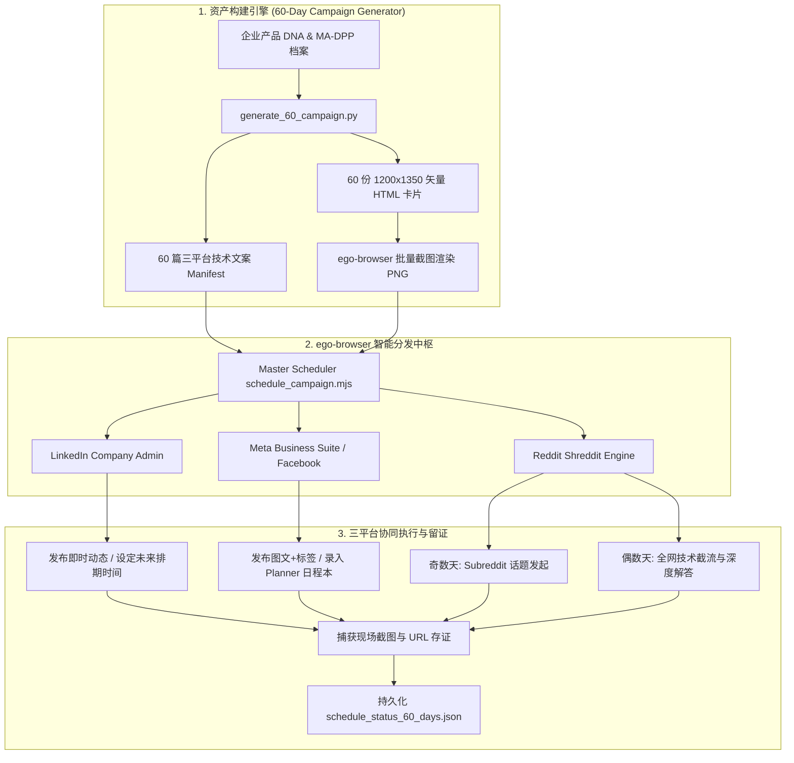

# B2B MA-DPP 三平台社交全媒体发布与 60 天自动化排期 Skill (`b2b-ma-dpp-social-publisher`)

本 Skill 专门用于工业出海与半导体 B2B 品牌，围绕 **欧盟数字产品护照 (MA-DPP / EU ESPR 2024/1781 & ISO/IEC 15459 Node 100015)** 构建全生命周期技术内容生产与社交分发自动化闭环。

通过与 `ego-browser` 深度整合，直接复用用户已登录的真实浏览器环境、Cookie 与权限上下文，彻底攻克现代社交媒体平台的反爬、验证码与 API 限制，实现 **LinkedIn 公司主页**、**Facebook 官方主页** 与 **Reddit 硬核技术社区** 的三平台协同分发：
1. **LinkedIn 公司主页 (Company Page)**: 官方权威发声、B2B 买家信任背书、多周定时发布队列。
2. **Facebook 官方主页 (Meta Business Suite)**: 全文案 + 完整标签 + 高清信息图标准流，日程本日历排期。
3. **Reddit 技术社区 (7大核心 Subreddit)**: 60天双轨交替节奏（奇数天发深度技术探讨、偶数天解答同行求助帖），深度触达欧美一线硬件工程师、嵌入式架构师与供应链决策人。

---

## 核心架构与能力矩阵



---

## 一、支持的工作模式与三平台策略

### 模式 A: 60天三平台矩阵化排期 (Tri-Platform Scheduling)
- **LinkedIn**: 每天在 CET 黄金时段（如 `09:15`, `14:30`, `10:45`）发布一篇图文，覆盖芯片认证、SGS 数据与国际标准。
- **Facebook (Meta Business Suite)**: 默认且必须包含完整标题、背景叙述、官网 URL、8个精选行业标签（#CosineChips #MADPP 等）以及 1200×1350 专业信息图，严格排期至日程本。
- **Reddit (60天交替节奏)**: 
  - **奇数天 (30个技术话题)**: 在 `r/embedded`, `r/ECE`, `r/SupplyChainTalks` 等板块发起工程探讨（如 ESPR 2024/1781 实施难点、RS-485 偏置与长线反射等）。
  - **偶数天 (30个专家解答)**: 全网检索同行工程求助帖，提供带公式、引脚图与热设计的干货答案，或跟进解答前一日自建话题下的工程师提问。

### 模式 B: 即时发布与截流回复 (Instant Publishing & Scout Reply)
- 支持单篇 LinkedIn 动态秒级发布。
- 支持单篇 Facebook 动态秒级发布。
- 支持指定 Subreddit 实时发帖，或针对高意向买家提问（如“How to collect DPP data from suppliers?”）即时提交技术回帖。

### 模式 C: 大盘状态与现场截图审计 (Live Proof Verification)
- 抓取 LinkedIn“已设定时间动态”日历视图。
- 抓取 Meta Business Suite 日程本 (Planner) 月度大盘。
- 抓取 Reddit 回帖与发帖的真实用户主页/帖子现场截图。

---

## 二、快速使用指南

### 1. 批量生成 60 天图文与信息图
```bash
python3 scripts/generate_60_campaign.py
```
生成：
- `campaign_manifest_60_days.json`: 60 天三平台排期字典（含 Reddit 奇偶天话题与回复模板）。
- `html_cards/day_01.html` 至 `day_60.html`: 1200×1350 4:5 纵向工业暗黑科技风信息图源码。

批量渲染 PNG 图片：
```bash
ego-browser nodejs < scripts/render_infographics.mjs
```

---

### 2. 即时发布到各平台
```bash
# 即时发布到 LinkedIn Company Page
node scripts/publish_instant_linkedin.mjs

# 即时发布到 Facebook 官方主页 (保证图文+标签全齐)
node scripts/publish_instant_facebook.mjs

# 即时发布到 Reddit (创建新话题)
node scripts/publish_instant_reddit.mjs --mode post --subreddit embedded --day 1

# 即时回复 Reddit 上的指定求助帖
node scripts/publish_instant_reddit.mjs --mode reply --url "https://www.reddit.com/r/SupplyChainTalks/comments/.../" --body "技术干货回答内容..."

# 全网自动检索并回复 Reddit 技术讨论
node scripts/reddit_scout_and_reply.mjs --query "RS-485 transceiver" --subreddit embedded
```

---

### 3. 执行三平台主控自动化排期
```bash
# 全平台执行
node scripts/schedule_campaign.mjs --platform all

# 仅执行指定天数 (如第 1 到 10 天)
node scripts/schedule_campaign.mjs --platform all --days 1-10

# 仅调度 Reddit 社区
node scripts/schedule_campaign.mjs --platform reddit --days 1-60
```

---

## 三、三平台 DOM 逆向与自动化交互规范

### 1. LinkedIn 公司主页
- **创建动态入口**: 搜索包含文本 `创建` 的按钮，随后点击二级菜单 `发动态`。
- **排期时钟图标**: 定位 `button[aria-label="设定动态发布时间"]`。
- **日期选择器**: 点击 `#share-post__scheduled-date` 唤起 Artdeco Calendar，计算目标日期的屏幕物理坐标 `page.mouse.click(x, y)` 触发 Ember.js 数据绑定。
- **媒体与文案**: 使用 `page.waitForFileChooser()` 上传信息图，聚焦 `.ql-editor` 注入文案。

### 2. Facebook (Meta Business Suite)
- **图文与标签全量默认规范**: 严禁只有图片没有文字。必须使用原生的 `await page.fill('div.notranslate._5rpu, [contenteditable="true"]', copy)` 触发 React/Draft.js 合成事件，确保文字、URL 与 Hashtag 矩阵 100% 同步提交。
- **排期防误发硬校验 (Guard)**: 开启“设置日期和时间”开关后，必须校验底部蓝色按钮文本已变成“预设时间”，杜绝排期脚本误直接发帖。
- **弹窗优雅关闭**: 遇“速推受众推广”等营销弹窗，自动点击“以后再说”或关闭按钮。

### 3. Reddit (Shreddit 架构与 Shadow DOM)
- **发帖页面预选**: 访问 `https://www.reddit.com/r/{sub}/submit` 自动锁定目标板块，跳过复杂的板块选择模态框。
- **标题输入框**: `<post-composer-title>` 封装在 Shadow Root 内，通过精确点击坐标 `{ x: 50, y: 160 }` 获取焦点并配合 `page.keyboard.type()` 输入标题。
- **正文富文本框**: 聚焦 `div[contenteditable="true"][aria-label="Post body text field"]`，逐行输入并触发段落换行。
- **评论回帖交互**: 定位 `shreddit-async-loader[bundlename="comment_composer"]`，点击“Join the conversation”展开富文本编辑器，输入专业干货后点击“Comment”提交。
- **社区反作弊频控**: 严格遵守 10:1 价值输出比，首帖不直接放商业购买链接，外部标准/白皮书链接引导至第一评论或主页。

---

## 四、技术与策略参考文档

- [Reddit B2B 技术社区获客与 60 天排期战略规范](references/reddit-b2b-strategy-spec.md)
- [LinkedIn 公司主页自动化规范与 DOM 映射](references/linkedin-company-automation-spec.md)
- [Meta Business Suite 排期与发帖规范](references/meta-business-suite-spec.md)
- [MA-DPP 欧盟法规框架与技术证据链](references/ma-dpp-regulatory-framework.md)
- [B2B 社交媒体排期最佳实践与频控策略](references/campaign-scheduling-best-practices.md)
